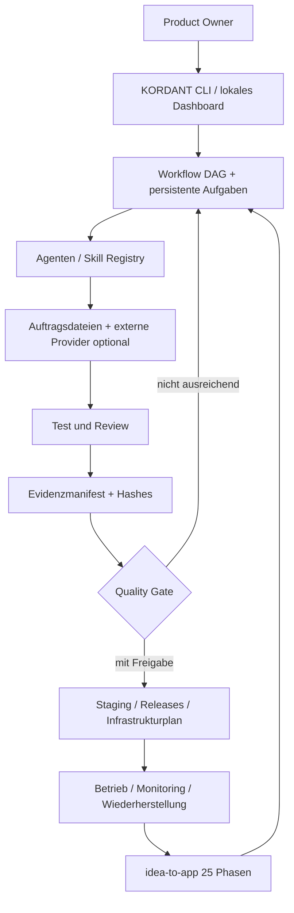

# KORDANT

**Agentic Product Engineering — von der Idee bis zum überprüfbaren Betrieb.**

KORDANT ist ein **lokal ausführbares, herstellerunabhängiges Engineering-Harness** für Produktplanung, Agentensteuerung, versionierte Skills, testbare Workflows, Nachweise, Sicherheitsgates und einen dokumentierten Weg bis zur eigenen VPS-Infrastruktur. Es ist bewusst kein unkontrollierter „baue alles automatisch“-Button.

> **Status 0.2.0 / Referenzimplementierung**: Die Kern-CLI, Workflow-DAGs, Taskverwaltung, Schreibbereich-Kollisionsschutz, Hash-Nachweise, statische Audits, Prompt-Erzeugung, Kostenjournal, Read-only-Dashboard, Gateway-Prüfungen und Deploy-/Migrationspläne sind implementiert und lokal testbar. **Nicht** implementiert oder extern bestätigt sind ein autonomer Cloud-Runner mit garantierter Sandbox, API-Abrechnung über Provider, echte Serverbereitstellung, kryptografische Audit-Logs, rechtsverbindliche Compliance-Freigaben und ein produktionsreifes Multi-User-Dashboard. Production ist absichtlich fail-closed.

## Inhalt

- **76 Agent Skills** mit eigenen Scope-, Vorgehens-, Sicherheits- und DoD-Regeln im offenen `SKILL.md`-Format.
- **18 Agentenrollen** einschließlich Product, Architecture, Hallmark/Taste Design, Full-Stack, Security, QA, SRE, Compliance, Finance und AI Engineering.
- **28 End-to-End-Workflows** mit Abhängigkeiten: neues Produkt, Projektübernahme, Feature, Bugfix, Security-Audit, Redesign, anbieterneutrale Migration, Release, Incident, Operations, KI-Funktion, Billing, Mobile, Compliance, Go-to-Market, Performance und Datenimport.
- **idea-to-app-Integration**: Mit exaktem Upstream-Commit `00dc23b8f3a20a829f07bd3b7411d6b7a0e12bda` (v1.2.0) als optional lokal installierbares Planungsfundament. Nicht automatisch eingebettet oder ausgeführt.
- **Read-only Skill Inspector**: `skill inspect /pfad/zu/skill` erkennt verdächtige Skripte, Symlinks, mögliche Privilegaktionen und fehlende Lizenzen; keine automatische Sicherheitsfreigabe.
- **Least-privilege-Standard**: keine externen KI-Aufrufe, kein Live-Deployment, keine Drittanbieter-Skripte und keine produktiven Änderungen per Default.

## Sofortstart: [START_HIER.md](START_HIER.md)

Der einfachste Weg für Nichtprogrammierer ist die Schritt-für-Schritt-Anleitung `START_HIER.md`. Für Claude Code und Codex liegt in `prompts/KORDANT_SELF_BUILD.md` ein ausführlicher Masterauftrag für den sicheren Ausbau.

## In 3 Minuten beginnen

Voraussetzung: Node.js 22+, Git optional; keine npm-Abhängigkeiten der Kern-CLI.

```bash
# Projekt herunterladen/entpacken und in den KORDANT-Ordner wechseln
node bin/kordant.mjs doctor
node bin/kordant.mjs init ../meine-app --name "Meine App" --kind saas --risk 2 --budget 25
node bin/kordant.mjs --project ../meine-app workflow start new-product
node bin/kordant.mjs --project ../meine-app task next
node bin/kordant.mjs --project ../meine-app status
node bin/kordant.mjs --project ../meine-app dashboard --port 3333
```

Die letzte Zeile öffnet einen **nur lokal lesenden** Projektüberblick auf `http://127.0.0.1:3333`.

### Bestehendes Repository

```bash
node bin/kordant.mjs audit ../existierende-app  # vollständig lesend, keine Dateien geändert
node bin/kordant.mjs adopt ../existierende-app --name "Meine Bestands-App" --risk 2
node bin/kordant.mjs --project ../existierende-app workflow start adopt-project
node bin/kordant.mjs --project ../existierende-app task next
```

### Agentenauftrag erzeugen und abarbeiten

```bash
node bin/kordant.mjs --project ../meine-app task claim TASK-xxxx
node bin/kordant.mjs --project ../meine-app agent prompt TASK-xxxx
# Prompt in einem realen, isolierten Claude/Codex/Agenten-Prozess verwenden.
# Die Agentenrechte müssen außerhalb von KORDANT wirksam begrenzt sein.
node bin/kordant.mjs --project ../meine-app task evidence TASK-xxxx --type test --file .kordant/reports/test-bericht.txt
node bin/kordant.mjs --project ../meine-app task evidence TASK-xxxx --type review --file .kordant/reports/review.txt
node bin/kordant.mjs --project ../meine-app task done TASK-xxxx
node bin/kordant.mjs --project ../meine-app gate release
```

Ein Task kann nur mit den **in seiner Taskdefinition vorgeschriebenen Nachweistypen** abgeschlossen werden. Die lokale Hash-Prüfung schützt gegen versehentlich nachträglich geänderte Evidenzdateien; sie beweist nicht deren inhaltliche Wahrheit.

### idea-to-app und Design-Skills

```bash
node bin/kordant.mjs --project ../meine-app idea info
# Wenn bereits ein lokaler Clone existiert:
node bin/kordant.mjs --project ../meine-app idea install --from ../idea-to-app
# Oder mit absichtlichem Online-Zugriff, auf den pinnten Git-Commit:
node bin/kordant.mjs --project ../meine-app idea install --online
```

Hallmark und Taste Skill sind im Design-Workflow als **geprüfte, manuell zu installierende Fremdskills** vorgesehen. Die externen Projekte werden weder stillschweigend ausgeführt noch ohne Lizenzprüfung vendort. Siehe [Design](docs/DESIGN.md) und [Integrationen](docs/INTEGRATIONS.md).

## Architektur



**Release-Fähigkeit ist kein automatischer Produktionszugriff**. Bei echten Nutzerdaten, Zahlungsfunktionen, Sicherheitssoftware und anderen regulierten Kontexten sind qualifizierte Fachprüfungen notwendig.

## Sicherheitsdemo ohne API-/Serverzugriff

```bash
npm run demo:safe
```

Die Demo verwendet einen temporären Projektordner und beweist, dass unvollständige Releases und Produktion standardmäßig blockiert sind. Sie löscht nur ihr eigenes temporäres Testverzeichnis.

## Wo ist was?

| Verzeichnis | Zweck |
|---|---|
| `src/`, `bin/` | Tatsächlich ausführbare CLI, Ereignisse, Task/DAG/Cost/Evidence und lokale HTTP-Ansicht |
| `skills/` | 75 Skills im offenen Agent-Skills-Format |
| `agents/` | Rollenprompts, Grenzen und Handoff-Vorgaben |
| `workflows/` | 28 JSON-Workflow-DAGs mit Scope und Pflichtbelegen |
| `docs/` | Architekturbuch, Release-Handbücher, Security, Betrieb, Design, Kosten, Recht, Business |
| `templates/` | PRD, ADR, Risiko, Incident, Migration, Evidence, Ops und Geschäftsmodelle |
| `infra/` | Nur als Beispiel geeignete Compose/Caddy/Backup/Restore-/Preflight-Dateien |
| `schemas/` | JSON-Schemas für Tasks, Workflows und Nachweise |
| `.github/` | CI der Kern-CLI; nicht die CI eines damit gebauten Produkts |
| `tests/` | Node-Built-in-Tests, ohne Netzwerk und Providerkosten |

## Für dich als Nichtprogrammierer

1. `idea-to-app` erstellt den Plan (geführt oder adaptiv). KORDANT übernimmt den Handoff.
2. Du gibst die wenigen wesentlichen Entscheidungen frei: Nutzer, Daten, Designrichtung, Budget, Servicelevel, externe Anbieter und Live-Launch.
3. KORDANT zerlegt Umsetzung und Prüfung in kleine Aufgaben. Du siehst belegte Ergebnisse, nicht nur KI-Erfolgsmeldungen.
4. Hallmark legt ein Designsystem fest, Taste überprüft die Qualität. Die Oberfläche muss weiterhin auf echten Geräten getestet werden.
5. Servermigration wird zunächst nur **geplant**. Echte Migration erst mit Inventar, Backups, Restore-Drill, Staging und menschlicher Freigabe.

## Grenzen / Sicherheitswahrheit

- Die wichtigsten Mechanismen **sind wirklich implementiert**, aber der Frameworkstand ist keine allumfassende fertige SaaS-Plattform.
- Drittanbieter-KIs können zusätzliche Kosten verursachen, die KORDANT ohne Provider-Abrechnung nicht sicher technisch stoppen kann. Externer Agentenstart verlangt daher zusätzliche explizite Zustimmung.
- Der lokale Audit erkennt typische Strukturlücken und einige Secret-Muster, ist **kein** Pentest, SAST/DAST oder Compliance-Siegel.
- Es gibt keine Anmeldung für das Dashboard; es ist **nur lokal** zu verwenden. Nicht auf deinem VPS öffentlich freigeben.
- Die Produktionsfreigabe wird absichtlich **niemals** als bestanden ausgegeben, solange eine echte unabhängige Prüfung fehlt.

Prüfergebnis: **29 lokale Tests grün**, kein echter VPS-/Providerlauf. Siehe [Prüfbericht](docs/TESTBERICHT_2026-11-23.md).

Weitere Informationen: [Technischer Gesamtplan](docs/MASTERBLUEPRINT.md), [Status & offene Arbeit](docs/STATUS_AND_ROADMAP.md), [Startanleitung](docs/USER_GUIDE.md), [Engineering-Verträge](docs/QUALITY.md).

**Lizenz:** MIT für den hier geschriebenen KORDANT-Code. Drittanbieterprojekte besitzen ihre eigenen Lizenzen.

## Anbieterneutral (v0.2.0)

Siehe [Provider-neutrales Deployment](docs/DEPLOYMENT_PROVIDER_NEUTRAL.md). Die standardmäßige `deploy plan`/`migrate plan`-Ausgabe ist herstellerunabhängig; IONOS existiert nur noch als optionales Legacy-Beispiel. Neue CLI-Befehle: `plan import`, `trace`, `journal seal/verify`, `skill pin/verify`, `git inspect`, `eval run`, `capability check` und `recovery inspect/block`.
